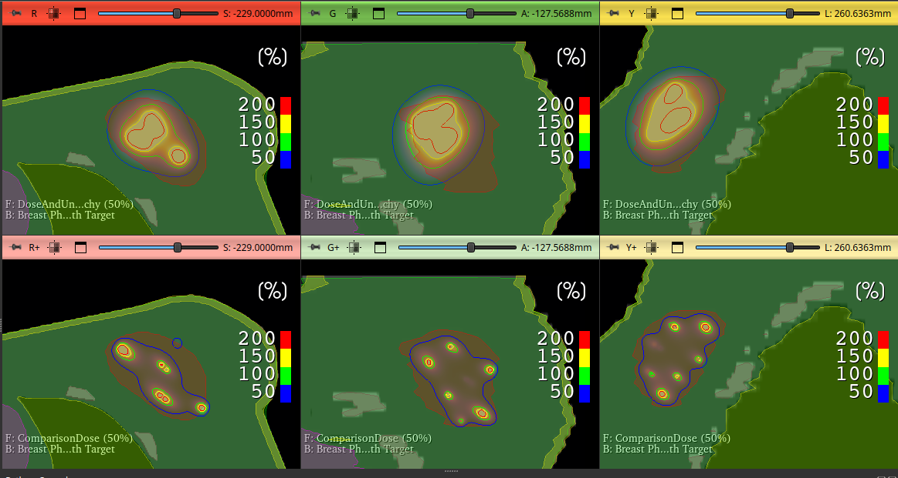

# Dose Comparison
If you have multiple dose distributions for the same patient, you can compare them in side-by-side viewing panels from the **Comparison tab**. You can either select a dose node that is already loaded into RapidBrachyMCTPS or load an external dose file.

{ width="900" }