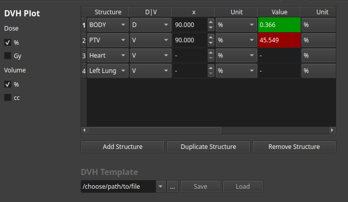
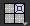
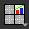
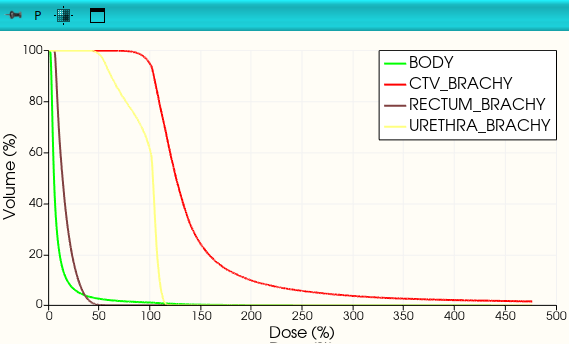

# DVH Metrics

You can view and analyze your DVH metrics in the **DVH tab** of the RapidBrachy module. 

1. Click the `Add Structure` button to add a structure for which you would like to see the DVH metrics. 
2. Select the structure from the `Structure` drop-down menu.
3. Select the metric you would like the see for that particular structure: D (Dose), V (Volume).
4. Enter the desired quantity for that metric along with the unit (% or cc).
5. A value will appear. You can view it as a percentage or in units of Gray.
6. You can also set an acceptable and ideal limit. These limits will colour the value box green if both limits are respected, yellow if only the acceptable limit is respected, and red if the acceptable limit is not respected.
7. You can also save a DVH template, which can be loaded back in later to restore your DVH settings.

{ width="600" }

The DVH plot should automatically appear in the top-right display panel. If it is not visible, you can restore it by clicking the layout menu { width="25" } and selecting the Four-Up Plot option { width="25" }. 

{ width="500" }

To change the axis units on the plot, use the toggles to switch between **Dose % and Gy**, and between **Volume % and cc**.
